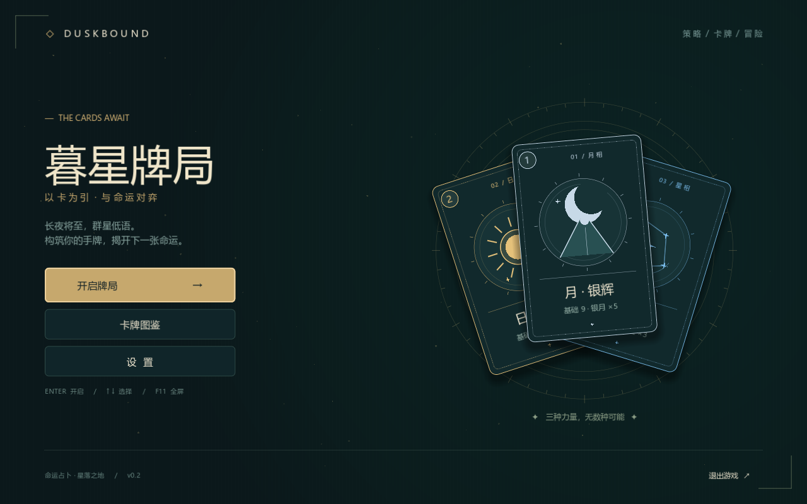
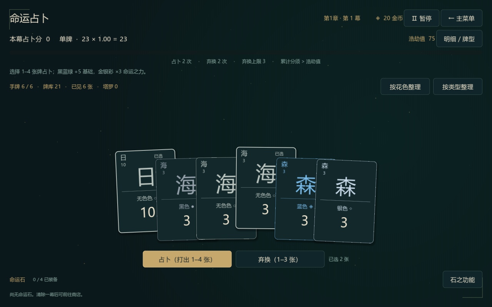

# FateCards · 暮星牌局

基于 **Godot 4.7.2 / GDScript** 的中文卡牌构筑原型。以“命运占卜”为主题，用牌型、颜色和命运石构筑分数，在有限的出牌次数内超越浩劫值。

```text
单次命运数值 = floor(基础值 × 命运之力)
本幕所有占卜累计分 > 浩劫值，即可过关
```



## 当前可玩内容

- 中文主菜单、六种命运牌图鉴、音量 / 全屏 / 动态设置。
- 27 张初始牌组；日、月、星空、大地、海洋、森林六种类型与七种颜色状态。
- 七种牌型，颜色与特殊命运叠加，实时计分预览。
- 初始手牌上限 6，每次出牌 1–4 张，每次弃换 1–3 张；每幕初始各 2 次。
- 横向重叠手牌、悬停与选中抬起、拖动换位、按花色 / 类型一键整理。
- 80 种命运石、塔罗改牌、源初升级、随机事件和幕间商店。
- 四幕一章，Boss 优惠券、梦境奖励和携带构筑进入下一章。
- 规则、牌局、菜单、鼠标交互自动检查，以及界面截图脚本。



## 快速开始

1. 安装或使用现有的 **Godot 4.7.2**，项目使用 Compatibility 渲染器。
2. 克隆仓库，在 Godot 项目管理器中导入根目录的 `project.godot`。
3. 按 **F5** 运行，点击“开启牌局”。首次打开请等待脚本和资源导入完成。

```bash
git clone https://github.com/macan9/FateCards.git
cd FateCards
```

无需安装第三方插件、Node.js 或 Python。界面由原生 Control 节点及矢量绘制组成。中文字体优先使用系统微软雅黑，并提供系统字体回退；跨平台发布前建议附带可分发的中文字体。

## 操作

| 操作 | 方式 |
| --- | --- |
| 选中 / 取消手牌 | 点击卡牌 |
| 调整出牌顺序 | 按住鼠标左键拖动，松开落位 |
| 按花色整理 | 点击手牌区右上方按钮，按颜色分组 |
| 按类型整理 | 点击对应按钮，按日 / 月 / 星空 / 大地 / 海洋 / 森林分组 |
| 出牌 | 选 1–4 张，点击“占卜” |
| 弃换 | 选 1–3 张，点击“弃换” |
| 查看计分与牌型 | 顶部“明细 / 牌型” |
| 暂停 / 返回上一层 | Esc |
| 切换全屏 | F11 |
| 键盘操作 | Tab、Enter、空格 |

所选牌按**当前手牌从左到右**结算。拖动和整理会影响结算顺序，但保留选中状态。最后一次占卜后不补牌；相等于浩劫值不算过关。

## 文档

- [设计思路](设计思路.md)：玩法目标、系统取舍、模块结构、手牌交互及后续计划。
- [玩法规则](玩法规则.md)：当前实现的完整规则、计分示例与暂定平衡数值。
- [调试指南](调试指南.md)：F5 / F6、断点、变量检查、日志、固定种子与测试命令。

## 项目结构

```text
project.godot                 项目配置与主场景入口
control.tscn                  主菜单
scenes/game_table.tscn        牌桌入口
scripts/
  fate_rules.gd               牌组、牌型与确定性计分
  fate_stones.gd              命运石数据表
  game_table.gd               牌局流程、商店、塔罗与奖励
  hand_fan.gd                 重叠布局、鼠标拖动与补牌动画
  game_card.gd                可复用卡牌绘制
  main_menu.gd                菜单及弹层
  preferences.gd              设置保存
  menu_theme.gd               共享主题与字体
tests/                       规则、玩法、菜单、手牌交互及截图检查
docs/images/                 README 界面预览
```

## 验证与调试

以下 PowerShell 命令在项目根目录执行。将 `$godotExe` 改为本机 Godot 可执行文件的路径。

```powershell
$godotExe = 'F:\Godot_v4.7.2-stable_win64.exe\Godot_v4.7.2-stable_win64_console.exe'
& $godotExe --headless --path . --editor --import --quit
& $godotExe --headless --path . --script res://tests/fate_rules_test.gd
& $godotExe --headless --path . --script res://tests/gameplay_smoke.gd
& $godotExe --headless --path . --script res://tests/menu_smoke.gd
& $godotExe --headless --path . --script res://tests/hand_interaction_test.gd
```

界面截图检查需要图形环境，不能加 `--headless`：

```powershell
& $godotExe --path . --script res://tests/ui_capture.gd --resolution 1280x800
```

截图输出到 `.godot/ui_previews/`，不会提交到 Git。测试使用独立牌局，不会改写牌局存档；当前也尚未实现牌局存档。

固定种子直接运行牌桌，便于复现发牌与后续随机流程：

```powershell
& $godotExe --path . res://scenes/game_table.tscn -- --seed=1763
```

相同种子需要配合相同操作顺序。详情见调试指南。

## 当前边界

这是可玩的原型，关卡曲线、商店价格和部分成长数值仍在验证中。暂未实现牌局存档、单牌多种独立颜色叠加、完整音乐资源和发布导出包。具体设计状态见[设计思路](设计思路.md)。
