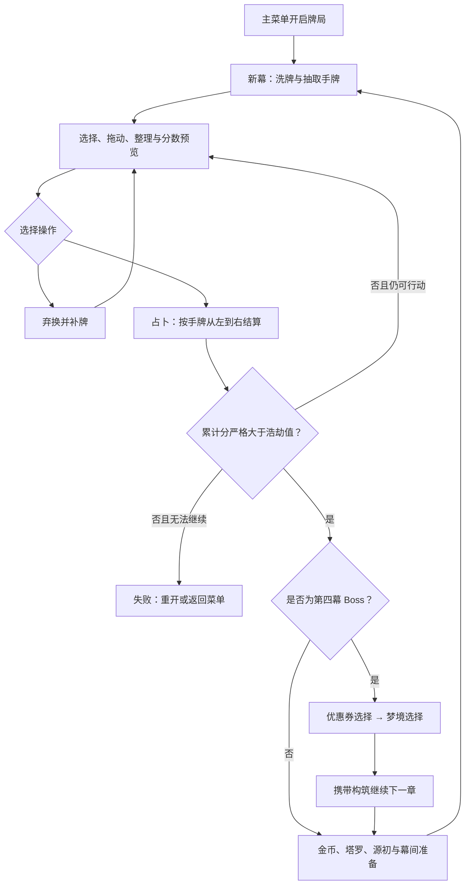

# FateCards · 命运占卜设计思路

> 本文对应当前 Godot 4.7.2 原型。重点解释为什么这样设计、当前代码如何实现，以及哪些内容仍待验证。精确数值与操作规则以《玩法规则.md》为准。

## 1. 体验定位

玩家扮演与命运对弈的占卜者，在有限的出牌、弃换和命运石槽位中，让一组普通的牌逐渐形成能够跨越浩劫的构筑。

核心体验由三个阶段组成：看懂一手牌的潜力，通过拖动与选择安排触发顺序，再通过幕间奖励改变下一手牌的可能性。整体采用较短的单幕节奏，把主要决策放在牌组、颜色、牌型等级与命运石的组合上。

设计借鉴类《小丑牌》的牌型计分与构筑循环，主题和规则围绕六种命运牌、日月组合及颜色对应关系展开。当前阶段先验证完整玩法闭环和操作手感，再扩充美术、叙事与内容量。

## 2. 三个设计支点

### 2.1 让分数可以推算

统一采用 `基础值 × 命运之力`，让玩家能分别理解“增加稳定底数”和“提高放大倍数”的价值。牌面、牌型、颜色、成长石分别影响这些数值，不同构筑可以在相同目标下采取不同路径。

界面在选择手牌时复用正式结算函数生成预览，避免出现一套预览公式和另一套实际公式。最终分数向下取整；累计分必须严格大于浩劫值，等于目标时仍需要继续出牌。

### 2.2 用资源限制制造取舍

初始手牌上限 6、出牌 1–4 张、弃换 1–3 张，每幕各有 2 次占卜与弃换。玩家必须在立即得分、保留组合和寻找特殊颜色之间取舍。

最后一次占卜不补牌，提前通关也不补牌。本幕弃牌与打出牌不洗回，基础局最多见到 `6 + 4 + 3 + 3 = 16` 张牌。这让弃换既是改善手牌的手段，也会消耗有限的信息与抽取机会。

### 2.3 让成长能够形成方向

命运石负责构筑主轴，塔罗负责改造具体卡牌，源初牌负责提高牌型底数，Boss 优惠券负责改变后续资源结构。四者作用于不同层面，避免所有成长都只是单纯加分。

例如，玩家可以选择强化森林与绿色的对应关系，也可以持续提高某个牌型等级；重复触发构筑则需要关注稀有颜色、特殊命运和所选牌的左右顺序。

## 3. 牌组、颜色与牌型

### 3.1 不对称的 27 张牌组

初始牌组包含日 1、月 1、星空 3、大地 6、海洋 8、森林 8。稀有种类拥有更高原始分值，常见种类更容易形成对子、三条和四条。

日月不允许增删、变化种类或通过覆盖复制数量，保留其唯一性和“命运（日月）”组合的辨识度。颜色、数值升级和标签仍可作用于日月，因此它们可以被强化，但不能依赖大量复制来消除稀有性。

这是一项当前原型的规则取舍，后续需要通过实际对局验证保护是否过强，以及日月构筑是否过度依赖抽取运气。

### 3.2 颜色形成第二条构筑轴

牌的类型决定基础分和同类组合，颜色决定额外基础或倍数。黑、蓝、绿每次触发增加 5 点基础；金、银、彩每次触发使命运之力乘 3。

特殊命运进一步强化主题关系：金日与银月乘 5；蓝星、黑星、黑地乘 3；蓝海、绿森乘 2。这些加成与颜色自身效果叠加，使“高分类型”与“适配颜色”形成不同的选择标准。

彩色可补齐同花，但不会模拟其他颜色的特殊命运或颜色石效果。这让它承担牌型兼容的用途，同时保留定向改色的价值。

当前每张牌只有一种颜色，改色会覆盖原颜色。原始设想中的“增加颜色”尚未扩展为多颜色模型，避免在规则验证阶段引入多重命中与重复倍率的歧义。

### 3.3 七种牌型保持识别成本可控

当前支持单牌、对子、三条、四条、同花、同花四条和命运（日月）。没有额外的两对等牌型；全部打出牌都会贡献牌面基础值。

同花要求四张有色牌形成同一种颜色，彩色可以补齐。判定优先级固定，保证同一手牌总能得到唯一牌型。牌型等级只影响对应牌型的基础与命运之力，便于玩家有方向地投入源初牌。

## 4. 单幕与整局循环

代码通过 `current_phase` 区分 `play`、`round_result`、`intermission`、`coupon`、`dream`、`victory`。这是状态标签驱动的流程控制，目前没有拆成独立状态对象。

弹窗返回时根据阶段恢复对应流程，防止关闭通关奖励后停在无法继续的牌桌。打开弹窗也会取消未完成的拖动并阻止底层手牌输入，避免奖励选择与牌桌操作同时发生。

## 5. 构筑成长各自解决什么问题

| 系统 | 设计目的 | 当前实现 |
| --- | --- | --- |
| 命运石 | 确立整局触发和成长方向 | 4 个初始槽位；同一石不能重复装备；满槽替换 |
| 塔罗 | 改善具体卡牌和牌组构成 | 加值、互斥标签、改色、变化、删牌、覆盖 |
| 源初牌 | 提高常用牌型的稳定收益 | 指定牌型升一级，本局保留 |
| 事件 | 提供经济与删牌的风险选择 | 猜牌、稳定收入、概率收入、概率销毁 |
| Boss 优惠券 | 改变后续行动资源或全局能力 | 倍率、基础、次数、手牌、金币、塔罗奖励 |
| 梦境牌 | 在章节节点提供更强的构筑改写 | 删两张、复制两张、彩色、随机传奇石 |

命运石当前包含 80 种：牌面 18、颜色 15、牌型 21、成长 9、经济 2、重复 5、功能 10。牌面部分按六种类型各三类加成实现，因此是 18 种；这与原始草案中“15 种”的笔误保留了明确区别。

成长保存在命运石自身的字典中。替换成长石会失去它累积的加成，形成“保留已有投资”与“换成更适合当前构筑的能力”之间的取舍。商店同幕选项固定，不会通过关闭重开刷新；每幕最多购买一块。

金运、原初、塔罗标签互斥，使一张牌需要在经济、成长与资源生成之间做选择。数值塔罗可以反复叠加，形成长期培养目标；其无限叠加的平衡仍需要后续验证。

## 6. 手牌交互为什么采用重叠与拖动

### 6.1 将手牌作为一个可操作整体

手牌在独立的 `HandFan` 控件中横向重叠，使用轻微角度与弧度形成牌扇。六张牌默认相邻间距约为牌宽的 66%，手牌增多后压缩间距，保持单行显示。

选中卡牌抬起 30 个逻辑像素，悬停额外抬起 16 个逻辑像素；拖动中的牌置于其他牌上方。左上角的小型类型与分值标记用于在被遮挡时辨认牌面。

### 6.2 点击与拖动明确区分

鼠标移动不足 8 个逻辑像素视为点击；超过阈值才进入拖动。这样普通点击时的轻微手抖不会导致换位，拖动放下也不会误触选中或取消。

鼠标按住期间持续跟踪移动与释放，即使拖出手牌区域也能结束拖动。目标位置按横向中心点映射到插入槽位，超出两端时钳制到首尾；其余牌平滑让位。切换窗口或打开弹窗会撤销尚未提交的拖动。

`HandFan` 统一进行重叠卡牌的命中判断，按显示层级选取目标。卡牌保留原生按钮的键盘能力，但鼠标由父控件处理，防止同一次释放既触发拖动又触发按钮点击。

### 6.3 顺序必须具有玩法含义

选中编号只记录“选了哪些牌”；正式出牌和预览都重新按 `hand` 的从左到右顺序收集这些牌。因此拖动、排序和“最后一张牌重复触发”使用同一顺序，没有隐藏的点击先后队列。

按花色整理使用无色、黑、蓝、绿、金、银、彩的顺序，同色再按类型排列；按类型整理使用日、月、星空、大地、海洋、森林的顺序，同类再按花色排列。相同条件按卡牌 ID 排序，保证重复点击结果稳定。

整理是一次性动作。补牌加入右侧，不强制覆盖玩家手动安排的顺序。拖动和排序保留选中状态，并即时更新分数预览。

### 6.4 复用卡牌节点

手牌通过卡牌唯一 ID 维护视图映射，抽走的节点才被移除，新抽到的牌才创建节点。选择、整理和预览更新复用原节点，保留键盘焦点，并使位置动画可以连续过渡。

图鉴与改牌选择器继续使用同一 `GameCard` 绘制组件，但不启用手牌拖动逻辑，避免把手牌行为扩散到所有卡牌展示场景。

## 7. 技术结构与数据边界

| 模块 | 当前职责 | 这样拆分的原因 |
| --- | --- | --- |
| `fate_rules.gd` | 牌组生成、洗牌、牌型识别、计分 | 将可重复验证的规则从界面中分离 |
| `fate_stones.gd` | 命运石条目、查找与随机候选 | 新增或调整常规石头优先改数据 |
| `game_table.gd` | 运行状态、出牌、改牌、商店、奖励及牌桌 UI | 让原型先完成闭环，后续再拆分服务 |
| `hand_fan.gd` | 布局、命中、悬停、拖动、位置动画 | 将交互细节与计分逻辑隔离 |
| `game_card.gd` | 卡牌数值、颜色、标签与提示的绘制 | 手牌、图鉴、选择器复用 |
| `main_menu.gd` | 菜单入口与设置、图鉴弹层 | 主菜单与牌局生命周期分开 |
| `preferences.gd` | 主音量、全屏、动态设置持久化 | 仅保存用户偏好，不混入牌局状态 |

卡牌目前采用字典模型，主要字段为 `id`、`suit`、`base`、`value_bonus`、`color`、`tag`、`copies`。`suit` 对应日月等类型，`color` 对应界面里的花色；命名差异在整理逻辑中显式处理。

运行时分为完整牌组 `master_deck`、本幕牌库 `draw_pile`、手牌 `hand`、弃牌 `discard_pile` 与打出记录 `played_pile`。改牌先作用于完整牌组，再同步当前相关牌堆；唯一 ID 避免复制、覆盖、拖动时将外观相同的牌混淆。

命运石效果通过 `effect` 与 `target` 标识解释。常规加成由计分模块处理；经济、成长、复制与删除等有副作用的效果由牌桌流程处理。原型尚未采用通用事件总线，也没有完整的自定义 Resource 数据层。

## 8. 计分顺序与可复现性

计分顺序固定为：当前牌型等级 → 全局基础 → 所选牌从左到右的牌面、颜色、特殊命运与匹配石头 → 牌型石头 → 成长积累 → 成长倍率与最终全局倍率 → 向下取整。

同一张牌有额外触发时，重复它的牌面基础、颜色、特殊命运、匹配的牌面 / 颜色石头。牌型基础只计算一次。金运收入按实际触发次数支付；其他标签是否重复，按各自所在的弃牌或获胜阶段处理。

随机数由牌局内的 `RandomNumberGenerator` 提供，可以通过 `--seed=1763` 固定首局随机序列。相同种子仍需配合相同操作顺序，因为商店、塔罗、事件也会消费随机数。

当前整数采用 Godot 的 64 位整数语义。随着无限章节与重复倍率增长，极端构筑可能超出合适的显示或数值范围；大数表示、科学计数和倍率上限尚未专项处理，这是后续扩展前需要解决的技术边界。

## 9. 视觉与反馈

现有画面使用深青绿色背景、米白正文与金色强调，突出占卜、星盘和稀有奖励。类型用文字和矢量符号识别，颜色同时以名称显示，避免完全依赖颜色区分。

优先使用原生 Control 容器和矢量绘制，让界面在资源较少的情况下仍可运行并适配窗口。主菜单卡牌是装饰性矢量插画，牌桌卡牌使用更紧凑的数字展示。手牌控件根据可用宽度计算间距；较长的改牌与奖励内容放入可滚动弹窗。

设置中的动态开关同时影响背景与手牌位置动画。关闭动画后交互仍可使用，布局即时更新。当前只有菜单合成按钮提示音，完整背景音乐和出牌音效尚未加入。

## 10. 测试如何保护核心体验

| 检查 | 当前覆盖内容 |
| --- | --- |
| `fate_rules_test.gd` | 27 张分布、颜色数量、七种牌型、特殊倍率、命运石、等级成长 |
| `gameplay_smoke.gd` | 次数限制、补牌上限、严格过关、标签、改牌、商店、源初、Boss 与跨章 |
| `menu_smoke.gd` | 主菜单加载、六种图鉴、设置、退出确认与开局入口 |
| `hand_interaction_test.gd` | 真实视口鼠标事件、点击 / 拖动阈值、换位、整理、弹窗隔离、动画落位与结算顺序 |
| `ui_capture.gd` | 标准及 960×600 窗口渲染，选牌 / 排序 / 拖动 / 扩展手牌和弹窗边界 |

一个关键回归用例：装备“最后一张牌重复触发”，选择金日与无色森林。当森林在最右侧时得 390 分，把金日拖到最右侧后，预览与实际出牌都应为 7425 分。它同时验证顺序、重复触发、颜色倍率、特殊命运与预览一致性。

界面截图通过实际渲染检查，不将纯逻辑测试等同于视觉验收。测试输出、导入缓存和临时截图保留在 `.godot/`，不纳入版本控制；README 只保留两张明确选出的展示图。

## 11. 已落地、暂定与后续计划

### 已落地

主菜单到四幕通关再进入下一章的闭环、基础牌组与计分、重叠拖动手牌、两种整理、命运石、塔罗、源初、事件和章节奖励均已接入可玩的流程。

### 暂定，需要平衡验证

- 每章四幕，首章浩劫值为 75 / 125 / 190 / 290，下一章翻倍。
- 初始 20 金币，每幕基础奖励 12 金币、1 张随机塔罗、1 张源初牌。
- 命运石售价为普通 12、稀有 15、传奇 20；具体增益与概率尚未形成最终平衡。
- 单牌、对子升级遵循原设定；三条及更高牌型的成长已补齐，但仍为暂定。
- 稀有颜色与特殊命运的乘法收益可能很快超过早期浩劫，需要重点观察取得频率、重复触发和关卡曲线，而不是仅凭单张分值判断。

### 后续优先级

1. **平衡与可读性**：记录通关率、常见牌型收益和构筑成长曲线；补充更完整的逐项计分反馈与大数显示。
2. **存档**：序列化完整牌组、牌型等级、命运石成长、库存、章节状态及随机数状态；处理版本升级兼容。
3. **结构拆分**：将 `game_table.gd` 中的运行状态、塔罗、商店、事件与奖励弹层逐步拆出，在保持现有测试的前提下重构。
4. **规则扩展**：先定义多颜色牌的匹配与重复规则，再考虑增加颜色；补齐更多事件、Boss 特性和构筑方向。
5. **发布体验**：引入可分发字体、正式美术与音频，完善分辨率及输入设备支持，建立导出配置。

上述为后续方向，未完成项不计入当前功能承诺。每次扩展先补规则示例与针对性检查，再调整数据与界面，保证设计文档、实际代码和玩家看到的反馈保持一致。
